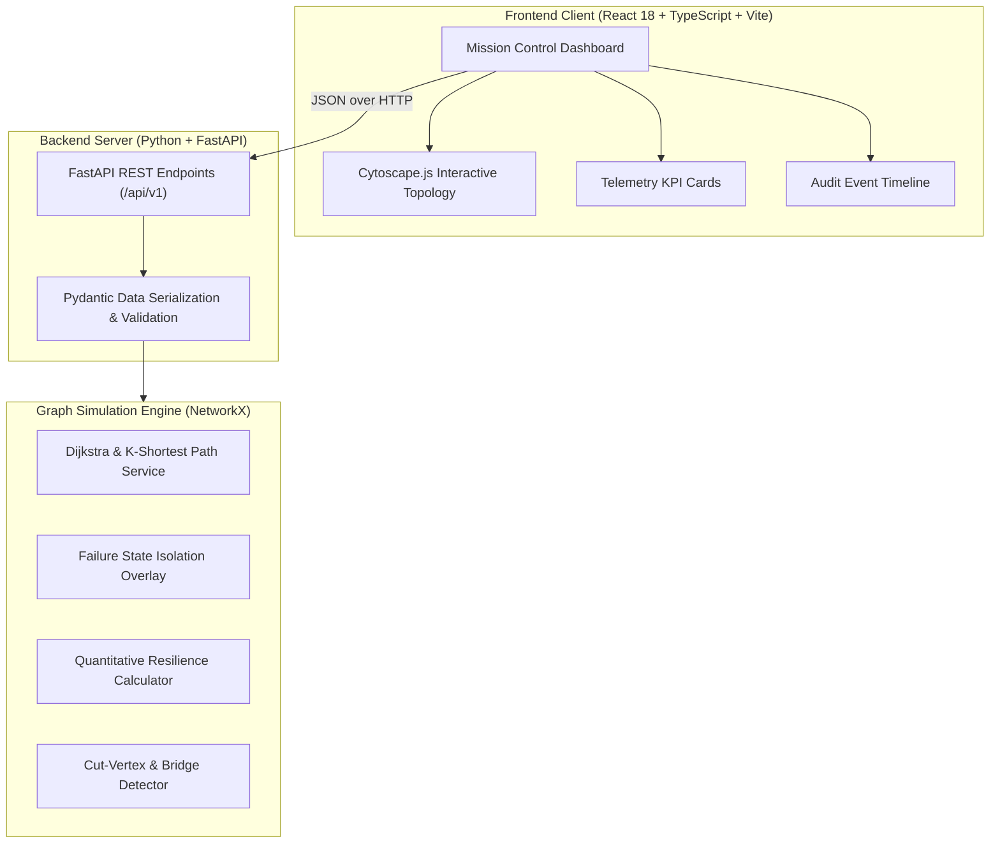

# SatNexus — Graph-Based Satellite Communication Network Resilience & Failure Recovery

[](https://github.com/struggler2028/satnexus/actions/workflows/ci.yml)
[](https://www.python.org/)
[](https://fastapi.tiangolo.com/)
[](https://react.dev/)
[](https://js.cytoscape.org/)
[]()
[](LICENSE)

> **Academic Course:** Agile Software Development (B.Tech 5th Semester, Odd 2026)  
> **Institution:** Jaypee Institute of Information Technology (JIIT), Noida  
> **Repository:** [https://github.com/struggler2028/satnexus.git](https://github.com/struggler2028/satnexus.git)  
> **Final Submission Deadline:** Saturday, November 21, 2026  

---

## 1. Project Overview & Problem Statement

Modern Low Earth Orbit (LEO) mega-constellations (e.g., Starlink, Kuiper, Telesat) utilize optical inter-satellite laser links (ISLs) to form orbital mesh networks in outer space. However, space debris, solar radiation, thermal eclipse battery depletion, and pointing misalignments constantly cause sudden satellite and link outages. When nodes fail along active transmission routes, data packets face immediate drops unless the constellation autonomously reroutes traffic around the failure.

**SatNexus** is a full-stack, software-defined satellite network resilience testing and monitoring platform. By modeling constellations as weighted graphs $G = (V, E, w)$—where vertices represent satellites and positive edge weights represent speed-of-light inter-satellite latency ($w > 0$)—SatNexus enables aerospace researchers and network operators to:
1. Interactively inspect dynamic orbital mesh topologies.
2. Select communication source and destination endpoints.
3. Compute Dijkstra shortest-path routes with sub-millisecond execution times.
4. Simulate satellite and link failures dynamically without corrupting base topology.
5. Trigger automated alternative route recovery and measure latency degradation ($\Delta L$).
6. Quantify constellation survivability via real-time resilience metrics (Node Availability %, Link Availability %, LCC Cohesion %, Pairwise Reachability %).
7. Proactively identify single points of failure (cut-vertices and bridges) via Tarjan's DFS.

---

## 2. System Architecture



---

## 3. Technology Stack

- **Backend:** Python 3.12 / 3.14, FastAPI 0.128, Uvicorn, NetworkX 3.6, Pydantic v2
- **Backend Testing:** Pytest 9.2, Pytest-Cov (Coverage: 88% overall, 91% on graph engine)
- **Frontend:** React 18, TypeScript, Vite 6, Tailwind CSS
- **Visualization:** Cytoscape.js 3.30 (Hardware-accelerated Canvas rendering)
- **Frontend Testing:** Vitest 3.2, React Testing Library, JSDOM
- **Continuous Integration:** GitHub Actions (`.github/workflows/ci.yml`)

---

## 4. Key Features & Implementation Status

| Feature ID | Capability | Status | Implementation Details |
|---|---|:---:|---|
| **P0-1** | Interactive Constellation Graph | **Done** | Cytoscape.js canvas with pan, zoom, dragging, and responsive coordinate layout. |
| **P0-2** | Positive Latency Edge Weights | **Done** | Enforces $w > 0$, rejects non-positive weights and self-loops. |
| **P0-3** | Source & Destination Selection | **Done** | Interactive dropdown and click selectors for communication endpoints. |
| **P0-4** | Dijkstra Shortest Path | **Done** | Min-heap Dijkstra computing optimal lowest-latency route in $< 1\text{ ms}$. |
| **P0-5** | State Isolation vs. Topology | **Done** | Dynamic failure state kept in separate sets (`failed_satellites`, `failed_links`); base graph is immutable. |
| **P0-6** | Dynamic Node Failure | **Done** | Point-and-click or button toggle; failed nodes render in red (#ef4444). |
| **P0-7** | Dynamic Link Failure | **Done** | Inter-satellite link failure simulation; renders as dashed lines. |
| **P0-8** | Automatic Route Recovery | **Done** | Failing any component along active route immediately triggers autonomous re-routing. |
| **P0-9** | Color-Coded Route States | **Done** | Green (Active), Red (Failed), Blue (Primary Route), Purple (Recovered Route). |
| **P0-10**| Network Disconnection Detection | **Done** | Graceful partition handling; renders high-visibility disconnection alert banner. |
| **P0-11**| Constellation Reset & Restore | **Done** | Single-click restoration returning all nodes/links to 100% healthy baseline. |
| **P0-12**| Resilience Analytics Engine | **Done** | Real-time Node Availability %, Link Availability %, LCC Ratio %, Reachability %. |
| **P0-13**| Simulation Event Audit Log | **Done** | Verifiable timeline logging timestamp, affected component, and latency impact. |
| **P1-1** | Articulation Points & Bridges | **Done** | Tarjan's DFS vulnerability detection modal identifying single points of failure. |
| **P1-2** | Constellation Scenarios | **Done** | One-click presets: Resilient Mesh (8 sat), Starlink Polar (10 sat), Walker Delta (12 sat). |

---

## 5. Quantitative Resilience Formulas

SatNexus mathematically evaluates constellation health under failure stress using deterministic equations:

1. **Node Availability ($A_{\text{node}}$):**
   $$A_{\text{node}} = \frac{|V| - |V_F|}{|V|} \times 100\%$$
2. **Link Availability ($A_{\text{link}}$):**
   $$A_{\text{link}} = \frac{|E| - |E_F|}{|E|} \times 100\%$$
3. **Largest Connected Component (LCC) Ratio ($\rho_{\text{LCC}}$):**
   $$\rho_{\text{LCC}} = \frac{|C_{\max}|}{|V|} \times 100\%$$
4. **Pairwise Reachability Ratio ($R_{\text{reach}}$):**
   $$R_{\text{reach}} = \frac{\sum_{u \neq v} \mathbb{I}(\text{path exists between } u \text{ and } v)}{|V_A|(|V_A| - 1)} \times 100\%$$
5. **Latency Degradation ($\Delta L$):**
   $$\Delta L = \left( \frac{L(P_{\text{recovered}}) - L(P_{\text{original}})}{L(P_{\text{original}})} \right) \times 100\%$$

---

## 6. Local Installation & Startup Instructions (Windows)

### Prerequisites
- Python 3.10+ (Python 3.12 or 3.14 recommended)
- Node.js 18+ & npm 9+
- Git

### Step 1: Clone the Repository
```powershell
git clone https://github.com/struggler2028/satnexus.git
cd satnexus
```

### Step 2: Start the Backend REST API
Open a PowerShell terminal:
```powershell
# Navigate to backend
cd backend

# Create virtual environment (optional but recommended)
python -m venv .venv
.\.venv\Scripts\Activate.ps1

# Install dependencies
pip install -r requirements.txt

# Run backend test suite
$env:PYTHONPATH="backend"
python -m pytest tests -v --cov=app

# Start FastAPI server
uvicorn app.main:app --reload --port 8000
```
*Backend will be live at `http://127.0.0.1:8000`. Swagger API docs available at `http://127.0.0.1:8000/docs`.*

### Step 3: Start the Frontend Mission Control
Open a second PowerShell terminal:
```powershell
# Navigate to frontend
cd frontend

# Install dependencies
npm install

# Run frontend test suite
npm test

# Launch Vite development server
npm run dev
```
*Open your browser and navigate to `http://localhost:5173`.*

---

## 7. Final Demonstration Scenario (10-Step Academic Presentation)

Follow this 10-step sequence for a complete college capstone presentation:

1. **Baseline Health:** Open `http://localhost:5173`. Observe the 8-satellite mesh. Notice the green status badge: `OPTIMAL CONSTELLATION` with 100% Availability and 100% LCC Cohesion.
2. **Route Selection:** In the Routing Engine tab, select **Source: SAT-A1 (ID: 1)** and **Destination: SAT-E5 (ID: 5)**.
3. **Primary Shortest Path:** Click **Compute Dijkstra Shortest Path**. Observe the active route `[SAT-A1 -> SAT-B2 -> SAT-D4 -> SAT-E5]` highlighted in **Blue (#3b82f6)** with latency `33.0 ms`.
4. **Targeted Failure Injection:** Switch to the **Failure Simulator** tab. Click **Simulate Failure** on **SAT-B2 (ID: 2)**.
5. **Visual State Transition:** SAT-B2 immediately turns **Crimson Red (#ef4444)** with status `FAILED`.
6. **Autonomous Route Recovery:** The route automatically recalculates to the alternative path `[SAT-A1 -> SAT-C3 -> SAT-D4 -> SAT-E5]`, dynamically animating in **Purple (#a855f7)**.
7. **Telemetry Impact:** Observe the updated metrics: Node Availability drops to `87.5%`, latency increases to `40.0 ms` ($+21.2\%$ degradation), and recovery computation executes in $< 0.5\text{ ms}$.
8. **Catastrophic Partition Simulation:** Click **Simulate Failure** on **SAT-C3 (ID: 3)** and **SAT-D4 (ID: 4)**. All surviving routes to SAT-E5 are now severed.
9. **Disconnection Warning:** Observe the immediate appearance of the **Network Partition Alert Banner** with status `DISCONNECTED`.
10. **Single-Click Network Restoration:** Click **Reset Constellation**. All failed satellites and links turn operational green; failure sets are cleared; and the primary shortest path is restored. Review the complete audit trail in the **Event Audit History**.

---

## 8. Agile SDLC Documentation Index

Comprehensive documentation is organized under the [`docs/`](docs/) directory:

- **Audit & Status:** [`docs/project-status.md`](docs/project-status.md)
- **Project Charter:** [`docs/project-charter.md`](docs/project-charter.md)
- **Problem Statement:** [`docs/problem-statement.md`](docs/problem-statement.md)
- **Requirements SRS:** [`docs/software-requirements-specification.md`](docs/software-requirements-specification.md)
- **Feasibility Study:** [`docs/feasibility-study.md`](docs/feasibility-study.md)
- **System Architecture (11 Diagrams):** [`docs/system-architecture.md`](docs/system-architecture.md)
- **System Design & Formulas:** [`docs/system-design.md`](docs/system-design.md)
- **REST API Specification:** [`docs/api-specification.md`](docs/api-specification.md)
- **Agile SDLC Suite:**
  - [Agile Methodology (Scrum + Kanban + XP)](docs/agile/agile-methodology.md)
  - [Product Backlog (22 User Stories, 78 SP)](docs/agile/product-backlog.md)
  - [Detailed User Stories (Given-When-Then)](docs/agile/user-stories.md)
  - [Sprint Planning & Catch-Up Plan](docs/agile/sprint-planning.md)
  - [Sprint 1 Report](docs/agile/sprint-1.md)
  - [Sprint 2 Report](docs/agile/sprint-2.md)
  - [Sprint 3 Report](docs/agile/sprint-3.md)
  - [Kanban Flow & WIP Limits](docs/agile/kanban-workflow.md)
  - [Extreme Programming (XP) Practices](docs/agile/extreme-programming.md)
  - [Definition of Ready (DoR)](docs/agile/definition-of-ready.md)
  - [Definition of Done (DoD)](docs/agile/definition-of-done.md)
  - [Daily Standup Records](docs/agile/daily-standups.md)
  - [Sprint Reviews](docs/agile/sprint-reviews.md)
  - [Sprint Retrospectives](docs/agile/sprint-retrospectives.md)
  - [Risk Register](docs/agile/risk-register.md)
  - [Team Contributions & Pair-Programming Log](docs/agile/team-contributions.md)
- **Testing Suite:**
  - [Comprehensive Test Plan (IEEE 829)](docs/testing/test-plan.md)
  - [TDD Strategy & Red-Green-Refactor Evidence](docs/testing/tdd-strategy.md)
  - [Detailed Test Cases](docs/testing/test-cases.md)
  - [Automated Test Results Report](docs/testing/test-results.md)
  - [Requirements Traceability Matrix (RTM)](docs/testing/requirements-traceability-matrix.md)
- **Trello Kanban Suite:**
  - [Board Setup Guide](docs/trello/board-setup.md)
  - [Product Backlog CSV Import](docs/trello/product-backlog.csv)
  - [Card Descriptions & Checklists](docs/trello/card-descriptions.md)

---

## 9. Team Roster & Academic Credits

- **Kabir** (`struggler2028`): Project Lead, Software Architecture, Sprint Planning, Git PR Reviews
- **Sarthak** (`sarthak-documentation`): Core Developer, Graph Algorithms, Sprint 1 Implementation, Testing Documentation
- **Agile Development Catch-Up Team**: Full-Stack Mission Control Dashboard, TDD Pytest & Vitest Suites, CI Automation, Comprehensive SDLC Documentation Suite
- **Academic Mentor / Evaluators:** Department of Computer Science & Engineering, Jaypee Institute of Information Technology (JIIT)
