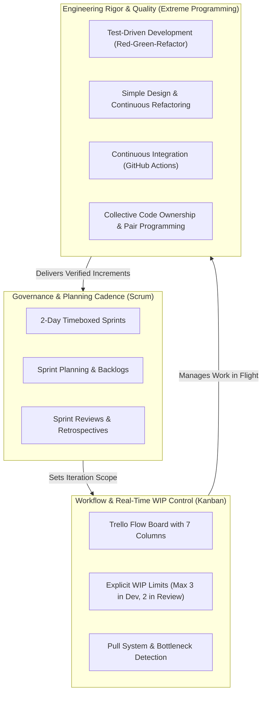

# Agile Methodology & SDLC Framework — SatNexus

**Project:** SatNexus (Graph-Based Satellite Communication Network Resilience)  
**Methodology:** Hybrid Agile (Scrum + Kanban + Extreme Programming)  

---

## 1. Why a Hybrid Agile Approach?

Agile is not a rigid dogma; it is an empirical process control framework designed to maximize customer value and team velocity while minimizing risk. In engineering an academic capstone with high algorithmic complexity and an urgent delivery deadline, no single framework is sufficient on its own:
- **Pure Scrum** provides excellent timeboxing and inspect-and-adapt cadences, but does not dictate engineering practices and can be sluggish when managing emergent mid-sprint tasks.
- **Pure Kanban** excels at flow optimization and visualizing bottlenecks, but lacks fixed iteration boundaries and structured ceremony schedules required for academic sprint grading.
- **Extreme Programming (XP)** provides the rigorous engineering practices (TDD, refactoring, continuous integration, simple design) essential for algorithmic correctness, but lacks project-level governance mechanisms.

**SatNexus integrates the three frameworks into a cohesive, complementary synthesis:**

---

## 2. Framework Roles & Responsibilities

### 2.1 Scrum (The Organizational Scaffold)
- **Timeboxed Sprints:** Three iterations: Sprint 1 (Nov 17–18), Sprint 2 (Nov 19), Sprint 3 (Nov 20–21).
- **Ceremonies:**
  - *Sprint Planning:* Estimating user stories using Fibonacci sequence (1, 2, 3, 5, 8, 13) via Planning Poker; committing to the Sprint Goal.
  - *Daily Standup (15 mins):* Addressing the 3 questions: What was done yesterday? What will be done today? Are there any blockers?
  - *Sprint Review:* Demonstrating working software increments to stakeholders.
  - *Sprint Retrospective:* Inspecting team processes (Start, Stop, Continue) to drive continuous improvement.

### 2.2 Kanban (The Continuous Flow Engine)
- **Visual Work Board:** 7 distinct lifecycle stages from `Product Backlog` to `Done`.
- **Work-In-Progress (WIP) Limits:** Explicit caps prevent multitasking thrash, reduce context-switching latency, and expose review backlogs immediately.
- **Pull Principle:** Developers pull cards into `In Progress` only when capacity under the WIP limit allows.

### 2.3 Extreme Programming (The Engineering Foundation)
- **Test-Driven Development (TDD):** Writing automated Pytest and Vitest test cases before writing application code. No code enters `main` without automated tests.
- **Simple Design:** Implementing only the minimum architecture necessary to fulfill the immediate user story (YAGNI — You Aren't Gonna Need It).
- **Refactoring:** Ruthlessly eliminating code smells, isolating state from topology, and improving algorithmic clarity while tests stay green.
- **Continuous Integration (CI):** Automating builds, lint checks, and test suites on every push via GitHub Actions.
