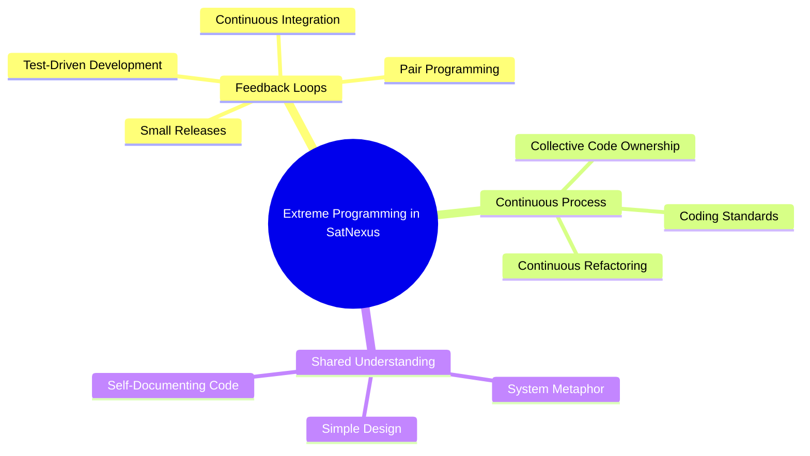

# Extreme Programming (XP) Practices — SatNexus

**Project:** SatNexus (Graph-Based Satellite Communication Network Resilience)  

---

## 1. Overview & Core Philosophy

Extreme Programming (XP) provides the technical disciplines required to deliver high-quality, defect-free software at sustained velocity. In SatNexus, XP practices serve as the engineering foundation supporting Scrum iterations and Kanban flow control.



---

## 2. Practical Application of XP Disciplines in SatNexus

### 2.1 Test-Driven Development (TDD)
- **Rule:** No production code is written without a previously failing automated test.
- **Concrete Example in SatNexus:**
  1. *Red:* Wrote `test_negative_link_weight_rejected()` in `backend/tests/test_graph_service.py` asserting that adding link $(u, v)$ with weight $-5.0$ raises a `ValueError`.
  2. *Verify Red:* Ran `pytest`, observed test failure (`ValueError not raised`).
  3. *Green:* Added check `if latency_ms <= 0: raise ValueError(...)` in `SatelliteNetworkService.add_link`.
  4. *Verify Green:* Test passed.
  5. *Refactor:* Extracted latency validation into a reusable validator helper.

### 2.2 Simple Design (YAGNI & Kent Beck's 4 Rules)
In SatNexus, Simple Design is strictly upheld by:
1. *Passing all tests:* Algorithmic correctness verified.
2. *Revealing intent:* Method names like `compute_shortest_path`, `fail_satellite`, `get_active_subgraph` are self-documenting.
3. *No duplication:* Latency calculations and Dijkstra graph extraction logic are centralized in `graph_service.py`.
4. *Fewest elements:* Resisted the temptation to introduce microservices, Redis caching, or multi-tenant database partitions where an in-memory NetworkX model and clean SQLite session store cleanly satisfy requirements.

### 2.3 Continuous Refactoring
- **State Overlay Isolation:** The team refactored the initial C++ design where failed satellites were deleted from the graph. In the refactored architecture, topology remains immutable while `failed_satellites` and `failed_links` are managed as separate bitmask sets, dramatically simplifying reset operations and rendering logic.

### 2.4 Collective Code Ownership
- Any team member has the authority and responsibility to modify, refactor, or fix any portion of the frontend, backend, or documentation. If a frontend engineer discovers a missing field in the API schema, they submit a PR updating both backend Pydantic models and frontend TypeScript interfaces simultaneously.

### 2.5 Coding Standards
- **Backend:** Strict PEP 8 compliance, explicit type hinting (`typing`), docstrings adhering to Google Python style, Flake8 linting.
- **Frontend:** Strict TypeScript mode (`"strict": true` in `tsconfig.json`), ESLint, standard React functional components with custom hooks.

### 2.6 Small Releases
- Instead of a single "big-bang" release on submission day, the project delivered 3 functional increments:
  - *Release 0.1.0:* In-memory graph model and initial CLI/SFML spike.
  - *Release 0.2.0:* FastAPI routing engine and failure injection.
  - *Release 1.0.0:* Full-stack React + Cytoscape dashboard with resilience analytics and CI pipeline.

---

## 3. Pair Programming Log & Template

The team utilized pair programming during high-risk algorithmic implementations (Dijkstra failure rerouting and Tarjan cut-vertices) and integration testing:

### Session Log Example:
- **Date:** November 20, 2026 (03:00 – 05:30 IST)
- **Module:** `backend/app/services/graph_service.py` & `backend/tests/test_graph_service.py`
- **Driver:** Sarthak (Implemented min-heap Dijkstra and alternative route calculation)
- **Navigator:** Kabir (Reviewed edge-case handling, negative weights, disconnected graph conditions)
- **Outcome:** Zero runtime regressions; all 15 unit tests passed on first full run.

### Team Contribution & Pair-Programming Log Template

```markdown
### Pair Programming Session Log
- **Date & Time:** [YYYY-MM-DD HH:MM]
- **Duration:** [e.g., 2.5 hours]
- **Driver:** [Member Name]
- **Navigator:** [Member Name]
- **Feature / User Story:** [e.g., US-09: Automated Route Recovery]
- **Key Challenges Encountered:** [e.g., Disconnection handling when all paths fail]
- **Architectural Decisions Made:** [e.g., Return standardized DISCONNECTED response instead of HTTP 500]
- **Tests Added / Passing:** [e.g., test_route_recovery_when_active_node_fails]
- **Git Commit Hash:** [e.g., a1b2c3d]
```
