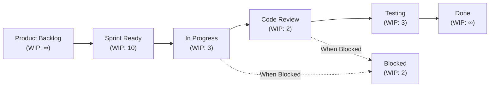

# Kanban Workflow & Flow Management — SatNexus

**Board Name:** `SatNexus | Agile Software Development`  
**Tool:** Trello / GitHub Projects  

---

## 1. Board Structure & Work-In-Progress (WIP) Limits

The Kanban board visualizes the continuous flow of user stories and tasks through 7 well-defined columns. Explicit WIP limits prevent multitasking thrash and expose bottlenecks immediately:

| Column Name | Purpose & Entry Policy | WIP Limit | Exit Policy |
|---|---|---|---|
| **1. Product Backlog** | Master repository of all uncommitted user stories, refactoring tasks, and technical debt. | $\infty$ | Story meets **Definition of Ready (DoR)** before being pulled into Sprint Ready. |
| **2. Sprint Ready** | Prioritized user stories selected for the active iteration, estimated in story points, with acceptance criteria. | 10 Cards | Developer has available capacity to pull into `In Progress`. |
| **3. In Progress** | Active implementation by an individual developer or pair programming pair. | **3 Cards** | Code written, unit tests passing locally, PR created. |
| **4. Code Review** | Peer review of Pull Request against coding standards and architectural rules. | **2 Cards** | At least one peer review approval, no unresolved comments. |
| **5. Testing** | Verification in staging/local integrated environment against acceptance criteria; CI green. | **3 Cards** | Meets **Definition of Done (DoD)**; automated test suite passes 100%. |
| **6. Done** | Fully verified, tested, merged into `main`, and documented. | $\infty$ | Product increment deployable and demo-ready. |
| **7. Blocked** | Tasks halted due to external dependencies or technical impediments. | **2 Cards** | Blocker resolved or task re-scoped. |

---

## 2. Card Label Taxonomy

Every card on the board carries standardized color-coded labels:

| Label Name | Color | Usage Context |
|---|---|---|
| `Priority: P0 - Critical` | Red | Non-negotiable core functionality (MVP requirements) |
| `Priority: P1 - Enhanced` | Orange | High-value enhancements (Scenarios, Tarjan cut-vertices) |
| `Priority: P2 - Low` | Yellow | Nice-to-have cosmetic or future improvements |
| `Component: Backend` | Blue | Python, FastAPI, NetworkX, Graph algorithms |
| `Component: Frontend` | Green | React, TypeScript, Cytoscape.js, Tailwind CSS |
| `Component: Graph Algorithms` | Purple | Dijkstra routing, BFS/DFS, Tarjan bridges |
| `Practice: TDD & Testing` | Teal | Pytest, Vitest, integration tests, test plans |
| `Practice: Agile & SDLC` | Pink | Sprint ceremonies, Trello artifacts, user stories |
| `Type: Bug / Defect` | Dark Red | Unintended behavior, zero-division error, rendering defect |

---

## 3. Flow Policies & Bottleneck Escalation

1. **Pull Principle:** Work is never pushed to the next column. A team member pulls a card only when the target column is below its WIP limit.
2. **Stop-the-Line Rule:** If the `Code Review` or `Testing` column hits its WIP limit, developers currently in `In Progress` must halt new coding and assist in reviewing PRs or executing tests to clear the bottleneck.
3. **Daily Standup Board Walk:** The daily 15-minute standup walks the board from right to left (`Testing` $\to$ `Code Review` $\to$ `In Progress`), focusing on finishing open work before starting new stories.
