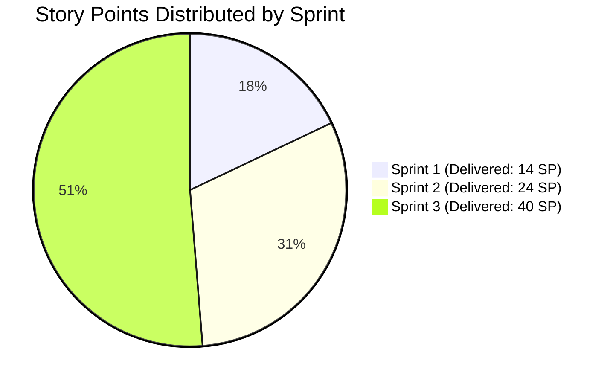

# Product Backlog — SatNexus

**Project:** SatNexus (Graph-Based Satellite Communication Network Resilience)  
**Total Estimated Story Points:** 78  
**Estimation Scale:** Fibonacci Sequence (1, 2, 3, 5, 8, 13)  
**Sprint Cadence:** 3 Sprints  

---

## 1. Master Product Backlog Summary Table

| Story ID | User Story Title | Priority | Story Points | Proposed Sprint | Status | Target Component |
|---|---|---|---|---|---|---|
| **US-01** | Repository & Environment Initialization | P0 | 2 | Sprint 1 | **Done** | Tooling / Git |
| **US-02** | Problem Statement & Scope Definition | P0 | 2 | Sprint 1 | **Done** | Documentation |
| **US-03** | Weighted Graph Constellation Data Model | P0 | 5 | Sprint 1 | **Done** | Backend Core |
| **US-04** | Initial Network Visualization Prototype | P1 | 5 | Sprint 1 | **Done** | Prototype / SFML |
| **US-05** | Dijkstra Shortest-Path Routing Engine | P0 | 5 | Sprint 2 | **Done** | Backend Engine |
| **US-06** | Interactive Source & Destination Selection | P0 | 3 | Sprint 2 | **Done** | Frontend / API |
| **US-07** | Satellite Node Failure Simulation | P0 | 3 | Sprint 2 | **Done** | Backend / State |
| **US-08** | Inter-Satellite Link Failure Simulation | P0 | 3 | Sprint 2 | **Done** | Backend / State |
| **US-09** | Automated Route Recovery & Recalculation | P0 | 5 | Sprint 2 | **Done** | Backend Engine |
| **US-10** | Path Highlighting & Visual State Transitions | P0 | 5 | Sprint 2 | **Done** | Frontend / Cytoscape |
| **US-11** | Network Partition & Disconnection Detection | P0 | 3 | Sprint 2 | **Done** | Backend Engine |
| **US-12** | Complete Constellation Reset & Restoration | P0 | 2 | Sprint 3 | **Done** | Full-Stack |
| **US-13** | Real-Time Quantitative Resilience Analytics | P0 | 5 | Sprint 3 | **Done** | Full-Stack |
| **US-14** | Mission-Control Web Dashboard (React/Cytoscape) | P0 | 8 | Sprint 3 | **Done** | Frontend UI |
| **US-15** | FastAPI REST API Architecture & Endpoints | P0 | 5 | Sprint 3 | **Done** | Backend API |
| **US-16** | Predefined Satellite Constellation Scenarios | P1 | 3 | Sprint 3 | **Done** | Backend / Data |
| **US-17** | Critical Cut-Vertices & Bridge Detection | P1 | 5 | Sprint 3 | **Done** | Backend Algorithms |
| **US-18** | Simulation Event Audit Trail & Logging | P1 | 3 | Sprint 3 | **Done** | Full-Stack |
| **US-19** | Test-Driven Development & Pytest Engine Suite | P0 | 5 | Sprint 3 | **Done** | QA & Testing |
| **US-20** | Frontend Component & Integration Testing | P0 | 3 | Sprint 3 | **Done** | QA & Testing |
| **US-21** | Continuous Integration Pipeline (GitHub Actions) | P0 | 3 | Sprint 3 | **Done** | DevOps / CI |
| **US-22** | Release Packaging, User Guide & Final Demo | P0 | 2 | Sprint 3 | **Done** | Release & Docs |

---

## 2. Velocity Tracking & Sprint Breakdown

- **Sprint 1 Velocity:** 14 Story Points (Foundational models and prototypes)
- **Sprint 2 Velocity:** 24 Story Points (Routing, failure simulation, rerouting)
- **Sprint 3 Velocity:** 40 Story Points (Full-stack web dashboard, resilience analytics, TDD suite, CI/CD, final catch-up)
