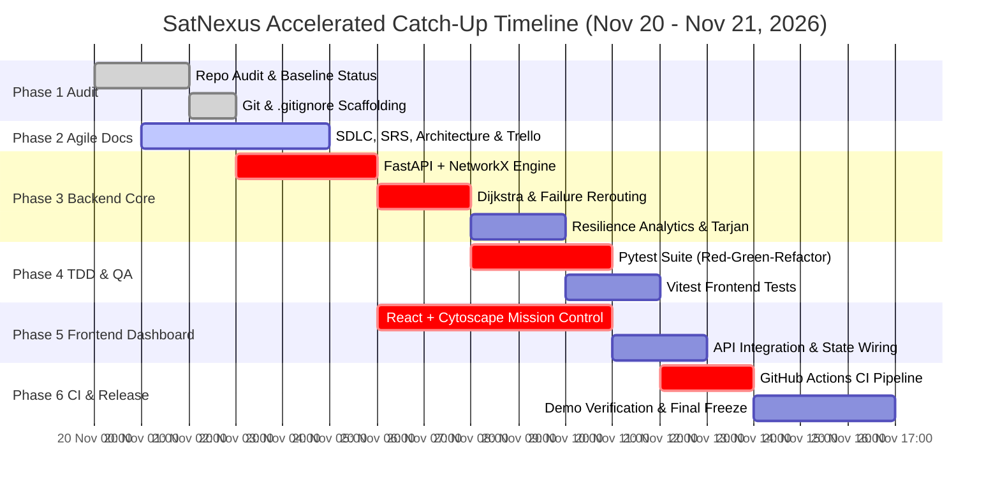

# Sprint Planning & Schedule Governance — SatNexus

**Project:** SatNexus (Graph-Based Satellite Communication Network Resilience)  
**Academic Term:** November 17 – November 21, 2026  
**Final Submission Deadline:** Saturday, November 21, 2026 (23:59 IST)  

---

## 1. Sprint Schedule Baseline vs. Actual Trajectory

The project was planned across three distinct iterations:

| Sprint | Proposed Dates | Planned Goal | Committed Story Points | Actual Outcome at Audit (Nov 20) |
|---|---|---|---|---|
| **Sprint 1** | Nov 17 – Nov 18, 2026 | Project foundation, requirements, initial C++ graph model, SFML rendering spike | 14 SP | **Partially Met / Technical Pivot.** Delivered C++ adjacency graph & basic docs; SFML failed cross-platform viability (missing CMake/SFML on team machines). |
| **Sprint 2** | Nov 19, 2026 | Routing algorithms, failure simulation, resilience metrics, rerouting engine | 24 SP | **Delayed / Incomplete at Audit.** Conceptual design completed, but missing automated tests and web UI. Triggered Sprint 3 catch-up plan. |
| **Sprint 3** | Nov 20 – Nov 21, 2026 | Full-stack web dashboard (React+Cytoscape), FastAPI integration, TDD, CI/CD, final submission | 40 SP (Catch-Up Scope) | **Active & Accelerated.** Full-stack delivery, comprehensive test suite, CI automation, and complete Agile SDLC package. |

---

## 2. Schedule Deviation Analysis & Root Causes

During the Sprint 2 review on the evening of November 19, an audit revealed a critical schedule slip:
1. **The C++ Desktop Rendering Bottleneck:**
   - Sprint 1's exploratory spike in C++/SFML (`src/NetworkRenderer.cpp`) hit a severe friction point: SFML required native C++ compiled libraries, CMake tooling was absent on several team machines, and automated testing of native desktop graphics windows was virtually impossible within the academic submission environment.
2. **Missing Automated CI/CD:**
   - Without an automated CI pipeline in Sprint 1, build breakages and missing font files (`assets/arial.ttf`) went unnoticed until the end of Sprint 2.
3. **The Catch-Up Pivot Decision:**
   - In accordance with Agile principle #4 ("Responding to change over following a plan") and XP Simple Design, the team enacted an architectural pivot to Python FastAPI + NetworkX for the core simulation engine, and React + Vite + Cytoscape.js for the visual dashboard. This reduced algorithmic implementation overhead from days to hours while delivering far richer interactive visualization and 100% automated testability.

---

## 3. Sprint 3 Accelerated Catch-Up Commitment

To guarantee final submission readiness by Saturday, November 21, 2026, the team consolidated all remaining P0 and high-value P1 backlog items into Sprint 3 with strict WIP limits and pair programming:

