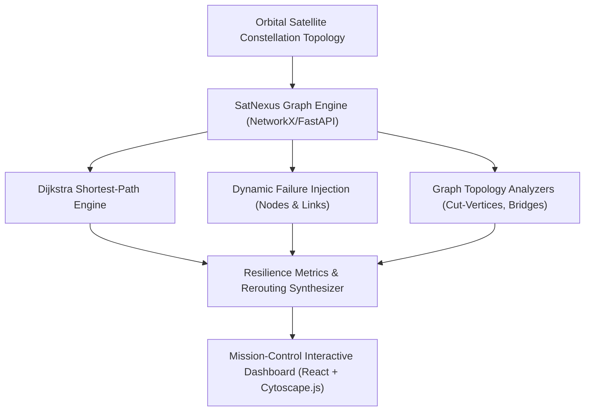

# Problem Statement & System Vision — SatNexus

## 1. Context & Operational Domain

Modern Low-Earth-Orbit (LEO) satellite constellations (e.g., Starlink with ~6,000+ satellites, Telesat Lightspeed, Amazon Project Kuiper) rely heavily on Inter-Satellite Optical Links (ISLs). Unlike legacy geostationary (GEO) satellites which act as bent-pipe transponders relaying data back to ground stations, LEO constellations form an orbital mesh network in outer space. Data packets hop from satellite to satellite across vacuum laser crosslinks before downlinking to a target ground station, achieving sub-optical fiber latencies across transoceanic routes.

However, operating a mesh network at an orbital altitude of 500–1200 km exposes nodes and links to severe environmental and structural hazards:
1. **Space Debris & Micro-meteorites:** Hypervelocity impacts can instantly disable satellite bus systems or solar arrays.
2. **Solar Flares & Radiation (Single-Event Upsets):** Cosmic radiation flips memory bits in flight computers, triggering sudden reboots or safe-mode transitions.
3. **Eclipse Thermal Cycling & Battery Depletion:** Passing through Earth's shadow forces satellites to conserve power, frequently turning off optical transceivers.
4. **Pointing, Acquisition, and Tracking (PAT) Loss:** Mechanical gimbal jitter or attitude thruster misalignment causes laser links to drop intermittently.

When an intermediate satellite or link in an active communication stream fails, the communication channel collapses unless the network immediately detects the disruption and recalculates an alternative loop-free path.

---

## 2. Core Engineering Problem

Traditional telecommunication network simulations either:
- Rely on heavy, proprietary, computationally prohibitive physical simulators (such as STK or NS-3 with complex orbital mechanics modules) that lack interactive, agile failure injection and rapid visual feedback.
- Or use oversimplified static graph demos that do not compute dynamic resilience metrics, cannot handle multi-node cascade partitions, and fail to provide immediate rerouting feedback for operational mission control.

The specific problems SatNexus tackles are:
1. **Graph Representation of Dynamic Orbital Topology:** How can an arbitrary constellation topology be modeled cleanly as a weighted graph $G = (V, E, W)$, where vertices represent satellites and edge weights represent latency?
2. **Deterministic & Minimal-Latency Rerouting:** When active routing paths encounter a failed node $v \in V$ or failed edge $e \in E$, how can the network autonomously identify the optimal alternative path $P'$ minimizing total path latency $\sum_{e \in P'} w(e)$?
3. **State Isolation vs. Topology Destruction:** In operational monitoring, a failed satellite must not be deleted from the graph database; it still physically exists in orbit. The system must maintain failure states independently of topological geometry.
4. **Resilience Quantification:** What quantitative metrics prove that a satellite network topology is resilient against failures, and how do we quantify network health degradation during an emergency?
5. **Critical Component Identification:** Which satellites and links represent single points of failure (cut vertices / bridges) whose failure would partition the constellation into disconnected islands?

---

## 3. System Vision & Value Proposition

SatNexus provides an interactive, full-stack satellite network resilience testing platform. It serves as both:
1. **An Engineering Sandbox:** Allowing aerospace and telecommunications researchers to load satellite topologies, simulate adverse space weather or hostile anti-satellite (ASAT) scenarios, and evaluate route recovery under stress.
2. **An Agile Exemplar:** Demonstrating how strict Agile methodologies—combining Scrum sprint cadences, Kanban limit controls, Extreme Programming (TDD Red-Green-Refactor, simple design, collective ownership), and automated Continuous Integration—can deliver a rock-solid, production-grade simulation tool under aggressive deadlines.

