# System Architecture & Technical Specification — SatNexus

**Document Version:** 2.0  
**Project:** SatNexus (Graph-Based Satellite Communication Network Resilience)  
**Architecture Pattern:** Clean Layered Client-Server Architecture (REST API + Reactive SPA)  

---

## 1. Architectural Overview

SatNexus utilizes a decoupled client-server architecture. The backend serves as the deterministic Graph Simulation Engine, maintaining topological models, routing algorithms, failure states, and resilience calculations. The frontend is a Single-Page Application (SPA) designed as an aerospace mission-control console, communicating with the backend over HTTP REST APIs and rendering interactive graph elements via Cytoscape.js.

---

## 2. Mermaid Diagrams Suite

### Diagram 1: System Architecture
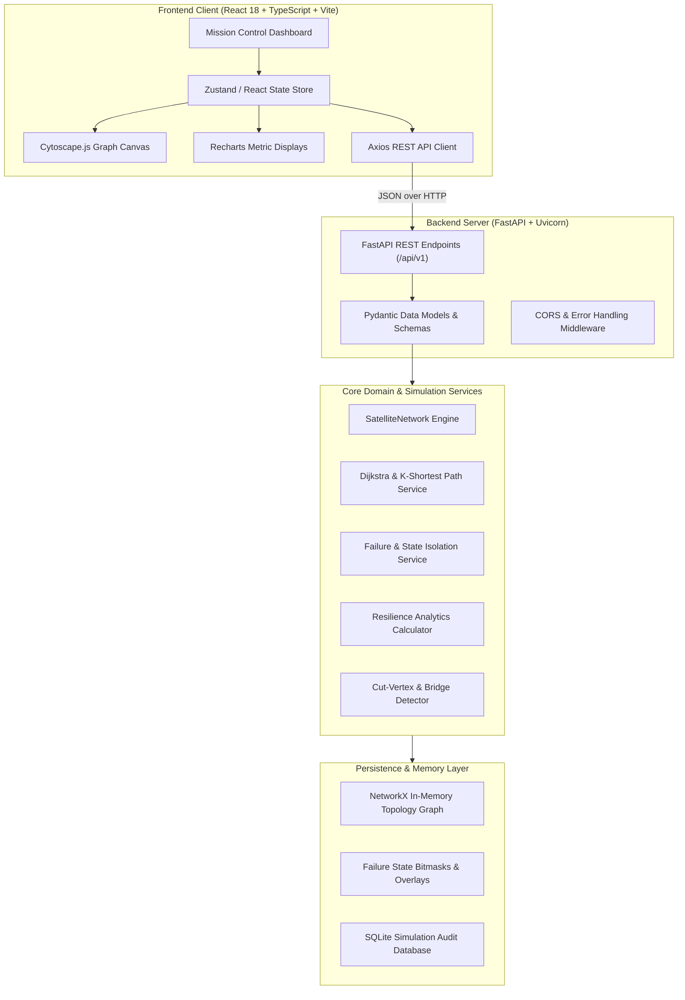

---

### Diagram 2: User Interaction & Use Case Diagram
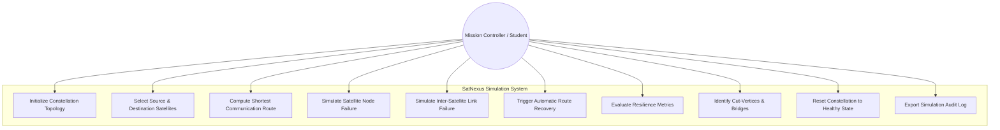

---

### Diagram 3: Domain Class Diagram
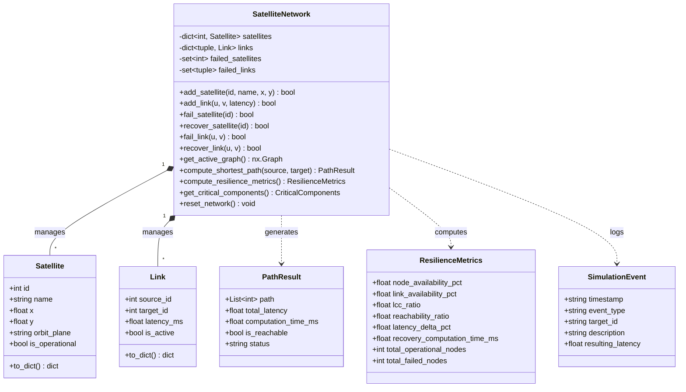

---

### Diagram 4: Sequence Diagram — Shortest-Path Calculation
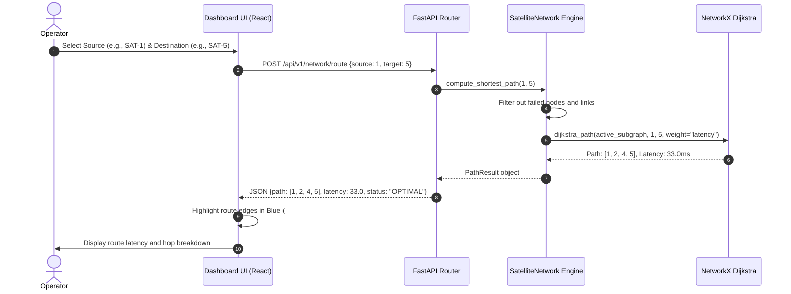

---

### Diagram 5: Sequence Diagram — Failure & Autonomous Route Recovery
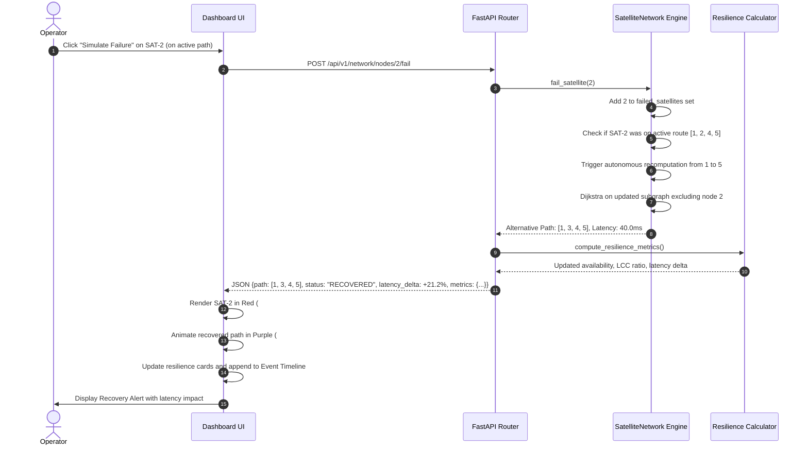

---

### Diagram 6: Activity Diagram — Failure Simulation Lifecycle
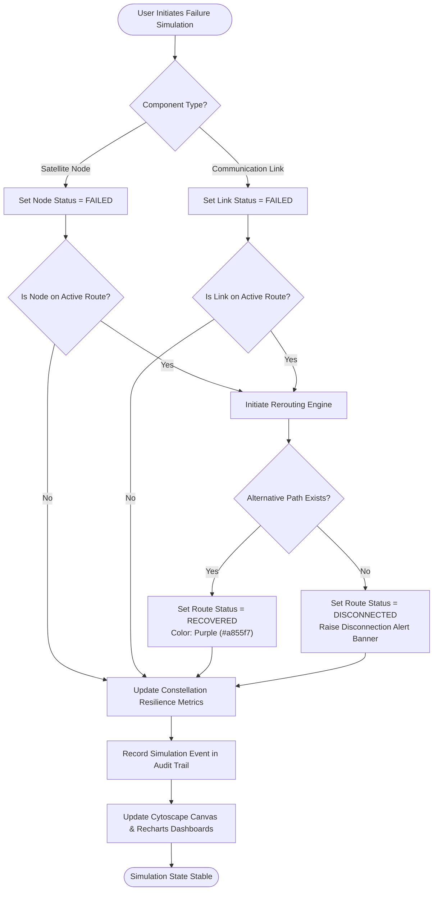

---

### Diagram 7: Component Diagram
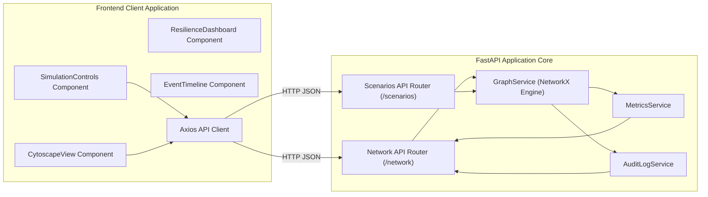

---

### Diagram 8: Database ER Diagram (Simulation Audit Persistence)
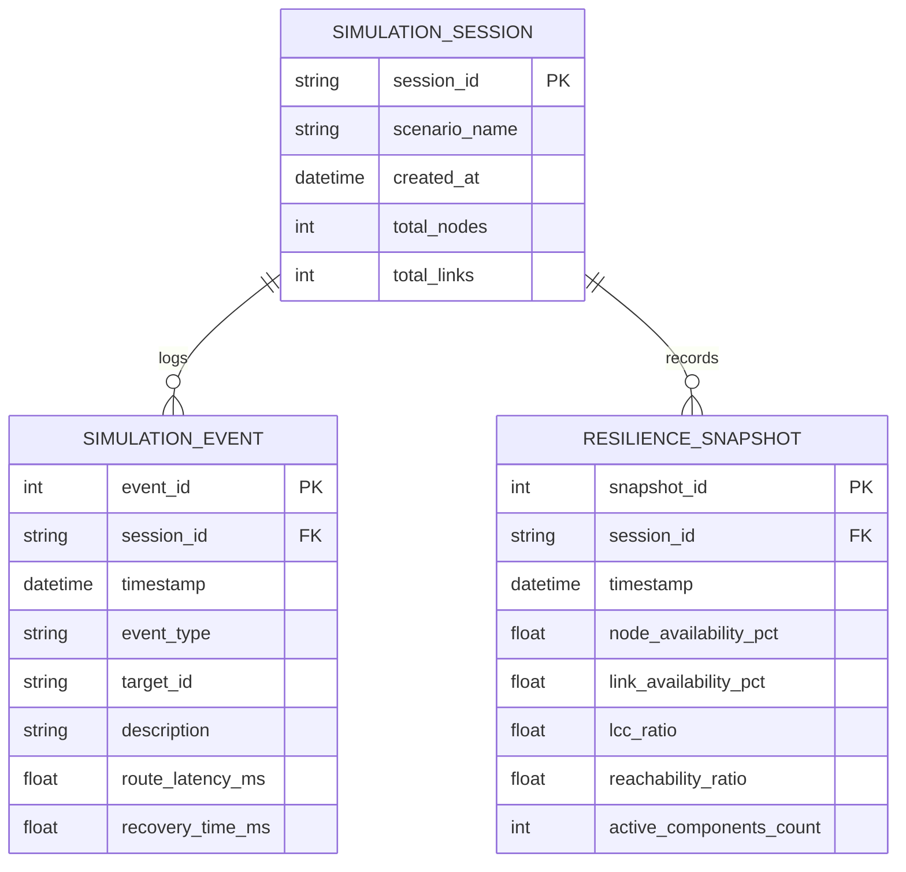

---

### Diagram 9: Agile Development Lifecycle
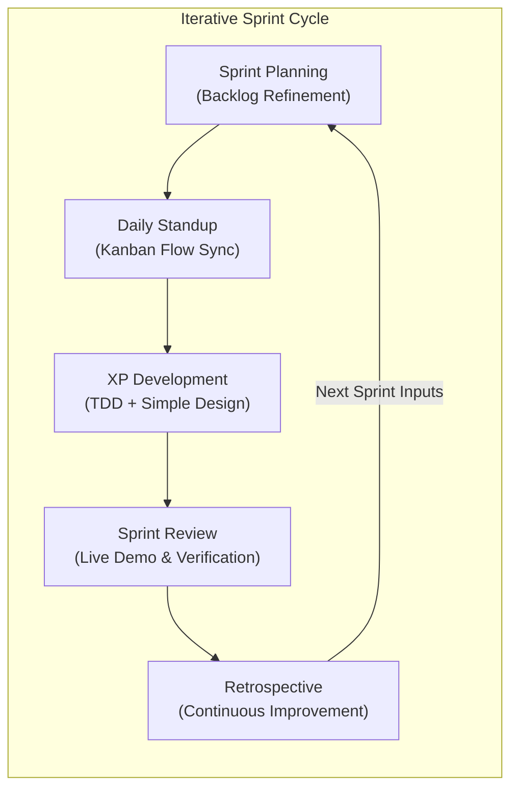

---

### Diagram 10: TDD Red-Green-Refactor Cycle
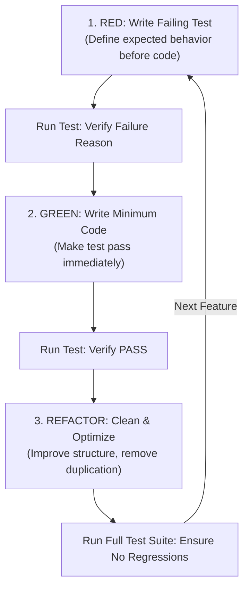

---

### Diagram 11: Continuous Integration Pipeline (GitHub Actions)
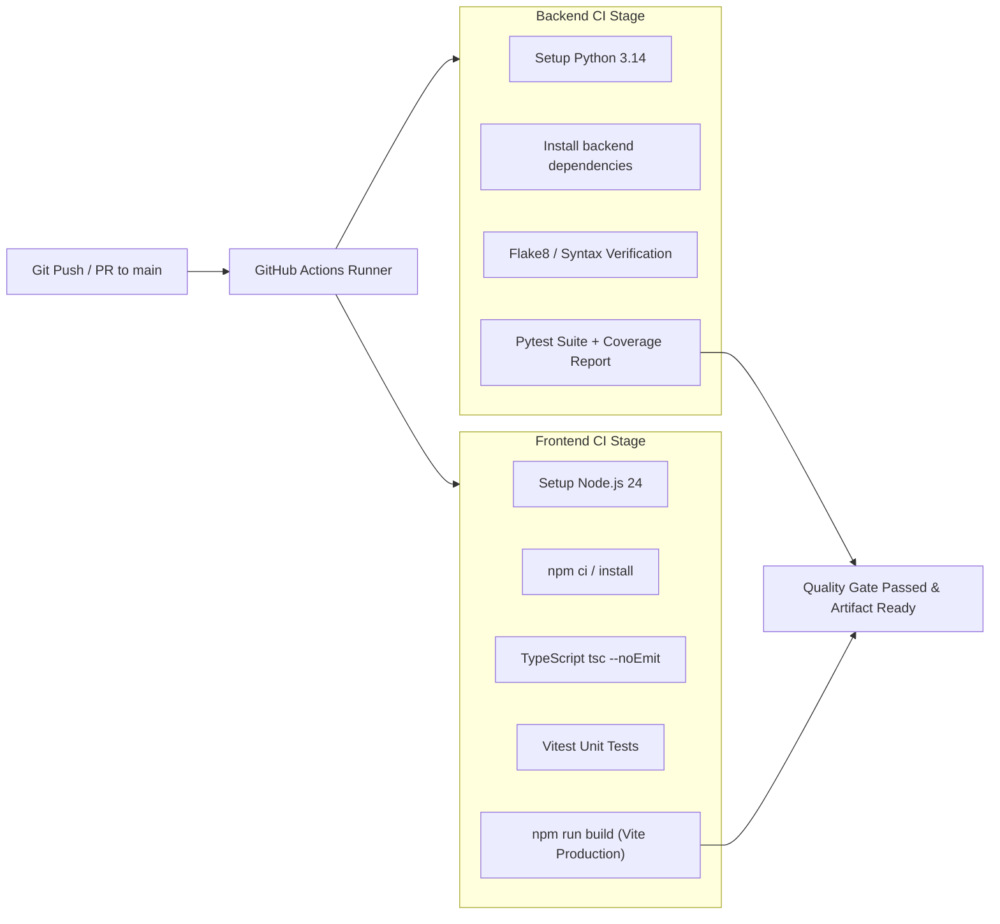
