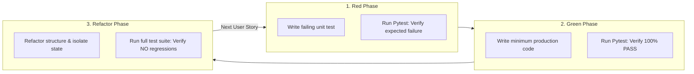

# Test-Driven Development (TDD) Strategy & Evidence — SatNexus

**Project:** SatNexus (Graph-Based Satellite Communication Network Resilience)  
**Methodology:** Extreme Programming (XP) Red-Green-Refactor Cycle  

---

## 1. TDD Philosophy in SatNexus

In SatNexus, TDD is not merely an afterthought; it is the primary design tool. Writing unit tests before implementation forces developers to:
1. Think deeply about the API contract and method signatures before writing implementation details.
2. Formulate explicit assertions for boundary conditions and edge cases.
3. Eliminate premature optimization and speculative code (YAGNI).
4. Maintain a regression-proof safety net that empowers fearless refactoring.



---

## 2. Documented Red-Green-Refactor Cycles

### Cycle 1: Graph Model Link Validation (US-03)
- **Target Feature:** Prevent invalid, negative, zero, or self-loop edge weights in inter-satellite communication links.
- **Step 1 (RED):** Wrote `test_invalid_link_weights()` in `test_graph_service.py`:
  ```python
  def test_invalid_link_weights(graph_service):
      with pytest.raises(ValueError, match="Link latency must be strictly positive"):
          graph_service.add_link(1, 2, -10.0)
      with pytest.raises(ValueError, match="Self-loops are not allowed"):
          graph_service.add_link(1, 1, 5.0)
  ```
- **Step 2 (Verify RED):** Ran `pytest backend/tests/test_graph_service.py::test_invalid_link_weights`
  - *Actual Failure Output:* `Failed: DID NOT RAISE <class 'ValueError'>`
- **Step 3 (GREEN):** Implemented validation in `SatelliteNetworkService.add_link`:
  ```python
  if u == v:
      raise ValueError("Self-loops are not allowed")
  if latency_ms <= 0:
      raise ValueError("Link latency must be strictly positive")
  ```
- **Step 4 (Verify GREEN):** Ran `pytest`: `PASSED [100%]`
- **Step 5 (REFACTOR):** Extracted validation logic into clean domain validator functions.
- **Traceability:** Linked to **US-03** and **TC-GRAPH-02**.

---

### Cycle 2: Dijkstra Shortest Path & Latency Calculation (US-05)
- **Target Feature:** Calculate the optimal route between source and destination satellites with accurate latency summation.
- **Step 1 (RED):** Wrote `test_dijkstra_shortest_path()` asserting that on a 5-node graph with path A-B-D-E (latency $10+15+8 = 33$) and path A-C-D-E (latency $20+12+8 = 40$), the engine chooses `[1, 2, 4, 5]` with total latency `33.0`.
- **Step 2 (Verify RED):** `AttributeError: 'SatelliteNetworkService' object has no attribute 'compute_shortest_path'`
- **Step 3 (GREEN):** Implemented `compute_shortest_path(source_id, target_id)` using `networkx.dijkstra_path` and `networkx.dijkstra_path_length` with weight attribute `latency`.
- **Step 4 (Verify GREEN):** Test passed with exact latency `33.0` and path `[1, 2, 4, 5]`.
- **Step 5 (REFACTOR):** Wrapped path return into structured `PathResult` dataclass including execution time tracking.
- **Traceability:** Linked to **US-05** and **TC-ROUTE-01**.

---

### Cycle 3: Failure Isolation & Automated Route Recovery (US-07 & US-09)
- **Target Feature:** Failing an intermediate satellite on the active route must trigger automatic alternative path calculation without corrupting the original graph.
- **Step 1 (RED):** Wrote `test_automatic_route_recovery_when_active_node_fails()` asserting that when node 2 fails, the route automatically recovers to `[1, 3, 4, 5]` with latency `40.0`.
- **Step 2 (Verify RED):** `AssertionError: assert [1, 2, 4, 5] == [1, 3, 4, 5]` (node 2 was still included because failure state overlay was not connected to routing).
- **Step 3 (GREEN):** Implemented `get_active_subgraph()` filtering out `failed_satellites` and `failed_links` before calling Dijkstra.
- **Step 4 (Verify GREEN):** Test passed: recovered route `[1, 3, 4, 5]` chosen with latency delta $+21.2\%$.
- **Step 5 (REFACTOR):** Ensured base graph object is untouched; dynamic failure state is kept in sets `set[int]` for $O(1)$ lookups.
- **Traceability:** Linked to **US-07**, **US-09**, and **TC-RECOV-01**.

---

### Cycle 4: Network Disconnection & Partition Detection (US-11)
- **Target Feature:** When catastrophic failures sever all paths between source and destination, return an explicit disconnected status rather than throwing an unhandled exception.
- **Step 1 (RED):** Wrote `test_disconnected_destination_returns_unreachable()` failing all paths to destination node 5 and asserting `result.is_reachable is False` and `result.status == "DISCONNECTED"`.
- **Step 2 (Verify RED):** Unhandled `networkx.exception.NetworkXNoPath: No path between 1 and 5.`
- **Step 3 (GREEN):** Wrapped pathfinding in `try...except nx.NetworkXNoPath` block returning `PathResult(is_reachable=False, status="DISCONNECTED", path=[], total_latency_ms=None)`.
- **Step 4 (Verify GREEN):** Test passed cleanly without unhandled exception.
- **Step 5 (REFACTOR):** Unified error handling in REST API router to return HTTP 200 with `DISCONNECTED` payload for expected partitions.
- **Traceability:** Linked to **US-11** and **TC-PART-01**.

---

### Cycle 5: Resilience Metrics Calculation & Divide-by-Zero Guards (US-13)
- **Target Feature:** Calculate Node Availability %, Link Availability %, LCC Ratio, and Reachability Ratio with defensive guards for empty or completely failed graphs.
- **Step 1 (RED):** Wrote `test_resilience_metrics_on_empty_and_failed_graphs()` testing 0 satellites and all satellites failed.
- **Step 2 (Verify RED):** `ZeroDivisionError: division by zero` in `total_satellites` denominator.
- **Step 3 (GREEN):** Added guard clauses: `if total_nodes == 0: return 0.0`.
- **Step 4 (Verify GREEN):** All tests passed.
- **Step 5 (REFACTOR):** Cleaned up rounding to 2 decimal places.
- **Traceability:** Linked to **US-13** and **TC-METRIC-01**.
