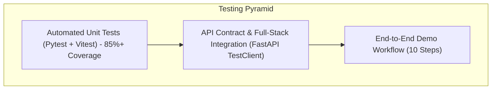

# Comprehensive Test Plan — SatNexus

**Document Version:** 2.0  
**Project:** SatNexus (Graph-Based Satellite Communication Network Resilience)  
**Standard:** IEEE 829 Software Test Documentation Standard  

---

## 1. Test Strategy & Scope

The testing strategy for SatNexus combines automated unit testing, algorithmic validation, edge-case robustness testing, API contract verification, and frontend component/UI testing.

### 1.1 In-Scope Testing
- Graph model construction, vertex/edge additions, weight validations.
- Dijkstra shortest path calculations with positive weights.
- Node failure injection and state isolation.
- Link failure injection and route recalculation.
- Multi-component failure cascades and network partition detection.
- Resilience metrics mathematical correctness and boundary conditions (empty graphs, all failed).
- Cut-vertex (articulation point) and bridge detection.
- FastAPI REST API response codes and JSON schema validation.
- Frontend Cytoscape canvas rendering and state-based color transitions.

### 1.2 Out-of-Scope Testing
- Real-world satellite hardware environmental stress testing.
- Physical orbital ephemeris validation against NASA SPICE kernels.
- Distributed network denial-of-service (DDoS) load testing.

---

## 2. Test Levels & Tooling

| Test Level | Scope / Objective | Framework / Tool | Success Threshold |
|---|---|---|---|
| **Unit Testing** | Individual classes, graph methods, metrics formulas | `pytest`, `pytest-cov` | 100% pass; $\ge 85\%$ coverage |
| **Edge-Case Testing** | Zero division, negative weights, disconnected targets, self-loops | `pytest` parameterized tests | All defensive exceptions handled cleanly |
| **API Integration** | Endpoint request/response contracts, status codes | `httpx`, `FastAPI TestClient` | 100% pass; 200/400/404 compliant |
| **Frontend Testing** | Component rendering, event handling, color coding | `Vitest`, `React Testing Library` | Zero rendering errors |
| **Continuous Integration** | Automated test execution on every commit | `GitHub Actions` | Clean pipeline run |

---

## 3. Test Pass/Fail Criteria

- **Pass:**
  - All automated test suites execute with 0 failures and 0 errors.
  - Shortest path matches mathematically proven Dijkstra paths.
  - Automatic rerouting immediately executes when an active route component fails.
  - Disconnected destinations cleanly return `is_reachable = false` without server crashes.
  - CI workflow achieves green status.
- **Fail:**
  - Any unhandled exception (HTTP 500) during normal or failure simulation flows.
  - Infinite loops during disconnected graph pathfinding.
  - Graph topology corruption following node recovery.
  - Any divide-by-zero crash in resilience metrics calculations.
